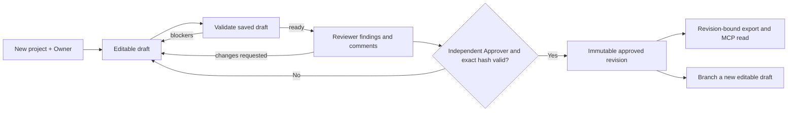

# 02 — Canonical domain model and persistence

## Boundaries

- **Account** (`UserId`) vs **project membership and project role** vs **customer application's design persona/user role** must not be confused. A `Super Admin` identity is not a customer-project membership; a revocable MCP `ClientId` is not a human role.
- **Project** has a stable `ProjectId`; **Draft** has `DraftId`, optimistic `DraftVersion`, and `RowVer`. Explicit immutable **ApprovedRevision** has `RevisionId`, `ContentSha256`, exact source Draft ID/version and validation run.
- Records use stable server IDs: `SourceId`, `SegmentId`, `CandidateId`, `RequirementId`, `FeatureId`, `ScreenId`, `RouteId`, `ActionId`, `ComponentInstanceId`, `CriterionId`, `BlueprintId`.
- **Scope invariant:** every object read/write, lookup, relationship, job and grant is checked against both the authenticated subject and `ProjectId` (composite FKs where possible). Guessing a UUID must not disclose data.

## Core relationships

| Entity | Parent | Key invariant |
|---|---|---|
| Projects | Accounts (creator) | Create project + assign first Owner in one transaction |
| ProjectMemberships + MemberRoles | Project + Account | Multiple explicit roles, last active Owner cannot be removed |
| ProjectDrafts + BuilderSteps | Project + Draft | Eight stage numbers exactly once; Save Draft permits incomplete steps; one active draft per project in current SQL candidate |
| ProjectSources + SourceSegments | Project + source | Private uploads; stable source anchors; unreadable/transcription uncertainty retained |
| CandidateClaims + ConfirmationDecisions + Evidence | Sources + Owner/Editor | AI suggested != confirmed; Editor proposal != Owner confirmation |
| Requirements + Features + Screens | Project | Owner authority for confirmed requirements; many-to-many feature/screen coverage |
| ScreenActions + NavigationRoutes | Screens | Enabled routes must point at selected existing screens; action/route IDs stable |
| ComponentInstances + BlueprintVersions + EditEvents | Screen + saved draft | Registry-protected props; append edit history; recompute validation impact |
| ValidationRuns + Findings | Exact draft/version/hash | RuleID, severity, object/fix; stale run cannot authorize approval |
| ApprovedRevisions + ApprovalEvents | Project + exact validated draft | Write-once snapshot, explicit Approver, no material self-approval |
| ExportJobs + ExportFiles | One approved Revision OR one named Draft version | Canonical 19 + manifest; each file's hash over emitted final bytes |
| ViewerResourceGrants + MCPGrants | Project + frozen Revision | Default deny; resource-action-version grant; revocation/expiry checked per request |
| ProcessingJobs + AuditEvents | Project or platform scope | Idempotency, bounded retry, no private content/secrets in operational logs |

## Draft / approval lifecycle

- All data writes that affect the draft increment `DraftVersion` and update `ETag`/hash in a single transactional unit. Do not accept a PUT that overwrites a newer draft version.
- **Confirming an AI claim is not final project approval.** Owner-only confirmation is AC-01D C1. Proposals retain author/decision provenance and original source anchors.
- Requirement/screen/action deletions trigger impact finding and dependent route/trace revalidation; stable IDs aren't reused. Archive where history requires.
- Editor vs Designer permission matrix is imported **unchanged** in `security/rbac_39_actions_delegated_baseline.csv`.
- New user-created project bootstrap occurs with Owner role in one atomic transaction. At least one active Owner remains.
- Approved revision content is immutable in both service layer and SQL trigger. Editing after approval creates a new draft.
- `DraftSha256` uses stable canonical serialized data; fix canonicalization algorithm before true cross-language hash parity (candidate: RFC 8785/JCS; decision still to be tested).

## SQL build warning

`database/sqlserver/001_foundation.CANDIDATE.sql` contains normalized table candidates and basic constraints; it has **not** been run on a SQL Server instance. Apply through EF migrations after reviewing composite FKs and naming. It does not replace runtime checks for project isolation, version consistency, last Owner, independent Approver, source provenance, or read grant expiry.

## Legacy 7 → 8 mapping

Before migrating any real project, show migration preview with old/new field mapping and hash. Persist migration event + reversible backup. Preserve original Step 7 review/export material in current Step 8 **Review & Export** without deleting old approved revisions. Migration implementation/tests are pending.
